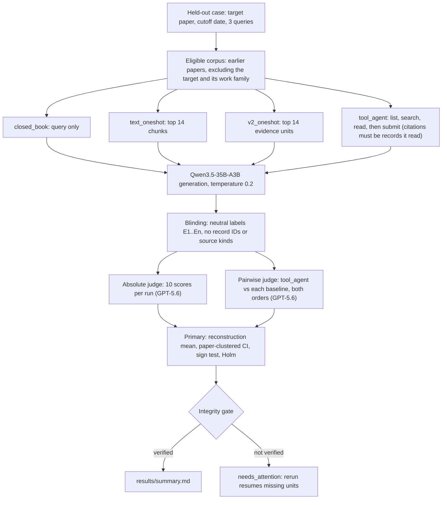

# Temporal evaluation v3: cutoff-audited tool agent vs. baselines

> **Caveat (added 2026-10-23, experiment 19).** The benchmark queries used here leak the held-out answer: 8% of the answer's words appear in broad queries, 20% in problem_constrained and 47% in expert_context, and per-unit overlap correlates 0.77–0.86 with judge scores. Paired comparisons between methods on the same query remain fair. Absolute scores, differences between query levels and conclusions about query inferability or evidence use are confounded. See [query_leakage/README.md](../query_leakage/README.md).


This experiment asks whether an agent that searches and reads only papers published before a target paper's date can reconstruct that paper's design better than simpler baselines. Generation runs on the local Qwen3.5-35B-A3B model. Judging runs on TRAPI GPT-5.6, so the generator never scores its own output.

**Status:** complete, with one open generation failure. 143 of 144 generations are valid and judged. The integrity gate reports `verified: false` for that single failed unit (see Results). `COMPLETE` is written only when the gate verifies, so it is absent.

## Question and scope

- **Targets:** 12 held-out papers from the 50-paper high-temperature HEA corpus (`temporal_v2/benchmark_cases/`). Each case has a hidden target (the paper's intervention, conditions, mechanism, and outcome). Hypotheses are compared with it.
- **Cutoff:** the held-out paper's earliest public date. A run may use only papers that were public before this date.
- **Query levels:** `broad`, `problem_constrained`, and `expert_context`, three queries per case from the benchmark case files.
- **Size:** 12 cases × 3 levels × 4 settings = 144 generation runs, with 144 absolute judgments and 108 pairwise units (12 × 3 × 3 comparisons, each judged in both orders).

## Settings

| Setting | What the generator sees | Citations allowed |
|---|---|---|
| `closed_book` | Query and cutoff only | None |
| `text_oneshot` | Top 14 text chunks from eligible papers, in one prompt | Those 14 records |
| `v2_oneshot` | Top 14 v2 evidence units from eligible papers, in one prompt | Those 14 records |
| `tool_agent` | Query and cutoff. Calls `list_papers`, `search_corpus`, and `read_record`, then `submit_hypothesis` | Only records the agent has read |

One-shot retrieval uses the same `retrieve` function as the earlier temporal benchmark.



## Temporal eligibility

A paper is eligible for a case only if:

1. it is not the target paper,
2. its earliest public date is before the cutoff, and
3. its `work_family_id` differs from the target's, so preprints and journal versions of the target are excluded.

Every tool call (`list_papers`, `search_corpus`, `read_record`) applies this rule, so the agent cannot see ineligible records. The audit checks every accessed and cited record. Any target, post-cutoff, or same-family record counts as a violation. The number of eligible papers per case is stored in each run record as `eligible_paper_count`.

## Tool agent

- **Budget:** at most 12 tool calls and 16 model turns. Tool calls past the budget are refused and logged.
- **Reading:** `search_corpus(query, k)` returns short snippets. `read_record(record_id, offset)` returns pages of 2,400 characters, so long records can be read in full.
- **Submission:** `submit_hypothesis` checks citations. A citation to an unread record is rejected with the reason, and the agent can fix it and resubmit.

## Generation and judging

- **Generator:** Qwen3.5-35B-A3B Q4_K_M through llama.cpp (`llama-server`, 4 slots, 32k context per slot). Hidden thinking is disabled. Temperature is 0.2 and the output cap is 5,000 tokens for every setting.
- **Judge:** GPT-5.6 deployment `gpt-5.6-sol_2026-07-09` on TRAPI, with JSON output and a 12,000-token output cap. This variant was chosen. The `luna` and `terra` variants were reachable but were not compared.
- **Blinding:** the judge sees the query, the hidden target, the hypothesis, and the cited evidence text. Record IDs, source kinds, citation-validation metadata, and setting names are removed, and cited records are relabelled E1, E2, and so on. Pairwise candidates are labelled A and B. Evidence text style can still differ between settings, and `closed_book` has no evidence at all, so pairwise comparisons with `closed_book` can reveal it.
- **Absolute judging:** each run gets 10 integer scores from 0 to 4 and a classification.
- **Pairwise judging:** `tool_agent` against each of the other three settings, in both presentation orders. If the two orders disagree, the result is a tie.

## Pre-specified analysis

- **Primary metric:** `reconstruction_mean`, the mean of the intervention, condition, mechanism, and outcome scores. These four dimensions are declared in `PRIMARY_DIMENSIONS` in code. The code defined them before any full-run results existed.
- **Primary comparisons:** `tool_agent` minus each of `text_oneshot`, `v2_oneshot`, and `closed_book` (`PAIRS` in code).
- **Unit:** the paper. A paper's difference is the mean across its three query levels.
- **Uncertainty:** 95% percentile interval from a cluster bootstrap over papers (10,000 resamples, seed 20260421).
- **Test:** two-sided exact sign test on per-paper differences, with Holm adjustment across the three primary comparisons. Other comparisons are exploratory and unadjusted.

## Integrity gate

`results/integrity_audit.json` reports `verified: true` only if all of the following hold:

- zero temporal violations, test-paper leaks, family leaks, unknown record IDs, invalid citations, and query leaks;
- 144 runs present, 0 failed, and 144 judged;
- 108 pairwise units judged;
- zero judge errors;
- one generator identity and one judge identity across all records.

## Changes made after smoke tests and before the full run

A one-case smoke test (PMC10759803) found the problems below. All were fixed before the full run started.

1. The tool agent's output cap (1,800 tokens) differed from one-shot generation (5,000). Both are now 5,000. The server also runs with temperature 0.2, so one-shot requests, which carry no temperature, match the tool agent's explicit 0.2.
2. The tool budget could be exceeded by one call within a batch. Calls past the budget are now refused.
3. `--resume` skipped failed runs. It now retries them.
4. The analysis read generator and judge identities from the current environment. It now reads them from the run and judgment records.
5. The judge saw record IDs and source kinds, which could reveal the setting. Payloads are now relabelled, and citation metadata is removed.
6. A single judge failure stopped the judge stage. Failures are now written to `judgments/errors/` and retried on resume, and the judge output cap rose from 6,000 to 12,000 tokens.

The generation stage of the full run started at commit `072cecd`. Commit `1b7f7a7` changes only judging and reporting code, so it does not change any generated run.

## Run and resume

```bash
cd materials-hypothesis-generation
tmux new-session -d -s mathg-eval-v3 -c "$PWD" 'bash run_eval_v3.sh; exec bash'
tmux attach -t mathg-eval-v3        # detach with Ctrl-b d
cat experiments/high_temperature_hea_qwen35b/eval_v3/status.json
```

The script starts its own Qwen server on port 8000 if none is healthy, and stops it on exit. It runs `generate`, `judge`, and `analyze` with `--resume`. `status.json` reports one of these states:

- `running`: a stage is in progress.
- `complete`: the run finished and `COMPLETE` was written.
- `needs_attention`: the integrity gate did not verify. Rerunning fills in the missing units.
- `failed`: a stage stopped. Rerunning resumes it.

## Outputs

- `runs/<case>__<level>__<setting>.json`: query, generation, cited evidence, tool trace, audit fields, and timing.
- `judgments/absolute/`: scores, classification, fatal errors, and the judge's explanation for each run.
- `judgments/pairwise/`: both presentation orders and the resolved outcome for each pair.
- `judgments/errors/`: failed judge jobs. It is empty when the run is complete.
- `results/analysis.json`, `results/integrity_audit.json`, and `results/summary.md`.
- `failed_attempts/`: copies of run records that failed generation, saved before a retry overwrote them.

## Results

### Run status

143 of 144 generations are valid and judged. One closed-book unit (`PMC11375712`, broad query) returned JSON without a `hypothesis` string on the first attempt and on one retry. That unit is reported as failed, and it is excluded from paired comparisons. Its paper's closed-book mean uses its other two query levels. I did not retry again, to avoid keeping only successful samples. The integrity gate therefore reports `verified: false`. All leak, temporal, citation, and judge-error checks are zero, and the only gap is this unit. Across the 12 cases, 38 to 49 earlier papers were eligible. Full tables are in [`results/summary.md`](results/summary.md).

### Primary metric

`reconstruction_mean` is the mean of the intervention, condition, mechanism, and outcome scores, on a 0–4 scale.

| Setting | Units judged | Reconstruction mean | Overall mean (10 dimensions) | Tool calls (mean) | Records accessed (mean) |
|---|---:|---:|---:|---:|---:|
| `tool_agent` | 36/36 | 1.64 | 1.84 | 12.0 | 18.9 |
| `text_oneshot` | 36/36 | 1.56 | 1.90 | 0 | 14 |
| `closed_book` | 35/36 | 1.56 | 1.89 | 0 | 0 |
| `v2_oneshot` | 36/36 | 1.49 | 1.85 | 0 | 14 |

Primary comparisons, with papers as the unit (12 papers):

| Comparison | Mean difference | 95% CI (papers bootstrap) | Papers tool higher / lower | Sign-test p | Holm p |
|---|---:|---|---:|---:|---:|
| tool_agent − text_oneshot | +0.08 | −0.07 to +0.21 | 7 / 3 | 0.34 | 0.34 |
| tool_agent − v2_oneshot | +0.15 | +0.01 to +0.30 | 9 / 3 | 0.15 | 0.33 |
| tool_agent − closed_book | +0.14 | −0.06 to +0.33 | 8 / 2 | 0.11 | 0.33 |

### Pairwise judgments

Each pair was judged in both orders. A verdict that flipped with presentation order counts as a tie. Every tie in this run was such a flip, so the judge never declared a tie that held in both orders.

| Comparison | Tool agent wins | Baseline wins | Ties (all position-inconsistent) | Tool win rate, excluding ties |
|---|---:|---:|---:|---:|
| vs `text_oneshot` | 16 | 12 | 8 | 0.57 |
| vs `v2_oneshot` | 20 | 10 | 6 | 0.67 |
| vs `closed_book` | 17 | 12 | 6 | 0.59 |

Pairwise results were not pre-specified for inference, so they are reported as counts only.

### Interpretation

- **Direction favors the tool agent, but no comparison survives correction.** The tool agent has the highest mean in all three primary comparisons and wins more decisive pairwise judgments. None of the differences survives Holm correction across the three primary tests. The v2 interval excludes zero, but its sign test does not, which reflects how little power 12 papers give.
- **Closed-book generation is nearly as good as retrieval.** Closed-book scores 1.56, the same as text one-shot, and sits only 0.08 below the tool agent. Either the judge rewards plausible generic HEA design, or Qwen already knows much of the target's design, since its training cutoff is undocumented. Until this is separated, the study cannot attribute the score to cutoff-restricted evidence.
- **The tool budget set how much the agent read.** The agent used all 12 tool calls in all 36 runs, so the budget, not the agent, decided how much it read. It cited 2.4 records per hypothesis on average, against 4.1–4.4 for the one-shot settings. In 7 of 36 runs, at least one submission was rejected for citing records the agent had not read. There were 8 rejections in total, and several cited bare paper IDs instead of record IDs. Its 10-dimension mean does not beat text one-shot (1.84 vs 1.90).
- **Exact reconstructions were rare.** At most one run per setting was judged an exact reconstruction, so the scores mostly reflect partial matches.

### Next steps

1. Calibrate the judge on about 30 items with a materials expert before trusting the absolute scale.
2. Test pretraining exposure: for example, check whether Qwen reproduces the target's design from its title alone, with no retrieval.
3. Remove the forced budget use (let the agent stop early) and vary the budget to test sensitivity.
4. Extend the set beyond 12 papers, since the current intervals are wide.


## Limitations

- **Small sample.** There are 12 papers with 3 queries each. Intervals will be wide, and results apply to this curated corpus of highly cited HEA papers.
- **Possible pretraining exposure.** Qwen's training cutoff is undocumented, so closed-book output may draw on memorized text about the target. A closed-book score close to the retrieval settings would suggest exposure rather than retrieval value.
- **One sample per cell.** Each query and setting is generated once at temperature 0.2. Run-to-run variation is not measured, so the intervals reflect only variation across papers and queries.
- **Unvalidated judge.** GPT-5.6 has not been checked against human experts, so scores are comparable only within this rubric. A calibration of about 30 items by a materials expert is the recommended next step.
- **Partial blinding.** Evidence style can differ between settings, and `closed_book` has no evidence. The absolute scores, one candidate at a time, are less affected than the pairwise comparisons.
- **Unequal information.** The tool agent can read up to 12 pages of 2,400 characters. One-shot settings see 14 retrieved records in a single prompt. The judge sees at most 1,200 characters of each cited record in every setting.
- **Not comparable with earlier results.** The earlier temporal benchmark was judged by Qwen, so these scores should not be compared with it.
- **Binding tool budget.** The agent always exhausted its 12 calls, so these results describe one budget, not the agent's own stopping behavior.
- **Single failed unit.** One closed-book generation failed and is missing from the results. Its effect on the closed-book baseline is small, but it is not zero.
