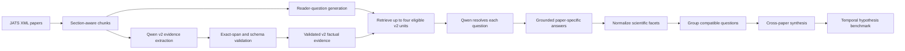

# Question-centered evidence experiment

This experiment makes scientific question clusters the agent-facing knowledge representation.
Normalized v2 evidence remains behind the interface to ground and validate paper-specific answers.

## Why this experiment exists

The original roles and isolated reader questions did not reliably preserve the scientific links
needed for hypothesis generation: material and state, intervention, test condition, measured
outcome, proposed mechanism, and limitation. This experiment tests a different interface:

```text
canonical scientific question
  -> equivalent question variants from the literature
  -> paper-specific grounded answers
  -> condition-aware cross-paper synthesis
  -> candidate hypothesis and discriminating experiment
```

Questions organize retrieval, but they do not replace evidence. Every answer points to a normalized
v2 evidence unit and carries exact XML spans. Unsupported questions remain explicitly unresolved
instead of being converted into facts.

## Pipeline at a glance



In brief, this pipeline starts with questions generated while reading the papers, finds evidence
that can answer each question, preserves unresolved questions as gaps, groups scientifically
equivalent questions across papers, and compares the different paper-specific answers.

## Shared factual foundation: v2 evidence

The questions are not the factual database. Both recent extraction pipelines rely on normalized
**v2 evidence**, stored in
[`../temporal_v2/materials_evidence_v2/`](../temporal_v2/materials_evidence_v2/).

V2 evidence was introduced because separate role outputs could lose the relationship among a
material, its processing, its structure, and its measured property. One v2 unit keeps the complete
scientific chain together:

```text
material and sample state
  -> processing or intervention
  -> resulting structure
  -> test conditions
  -> measured outcome
  -> baseline or comparison
  -> proposed mechanism
  -> boundary or limitation
  -> exact source text
```

### How v2 evidence is extracted

Qwen reads one bounded paper section at a time and is instructed to:

1. identify a specific material and sample state;
2. preserve ordered processing steps;
3. record structure observations and how they were measured;
4. attach the exact test temperature, environment, load, time, or simulation conditions;
5. retain numerical results, units, uncertainties, and measurement methods;
6. identify the baseline, changed variables, controlled variables, and confounders;
7. distinguish an observed result from an inferred or hypothesized mechanism;
8. record boundaries, failures, null results, and limitations when stated;
9. copy exact contiguous source spans; and
10. avoid guessing missing values or silently converting units.

The model returns records with this structure:

```json
{
  "unit_id": "PMC123::hypothesis_evidence_v2::...",
  "paper_id": "PMC123",
  "study_type": "experiment",
  "claim_ownership": "current_paper",
  "sample": {},
  "process_steps": [],
  "structure_observations": [],
  "test_conditions": {},
  "measurements": [],
  "comparison": {},
  "mechanisms": [],
  "boundaries": [],
  "limitations": [],
  "evidence_spans": [],
  "source_section": "Results",
  "extraction_confidence": 0.95,
  "result_revealing": true
}
```

### Important v2 fields

| Field | What it preserves |
|---|---|
| `sample` | Sample ID, material, composition, form, initial state, orientation, and density/porosity |
| `process_steps` | Ordered actions, parameters, and resulting sample states |
| `structure_observations` | Phase, grain, precipitate, defect, or scale observations and methods |
| `test_conditions` | Temperature, time, environment, pressure, load, strain rate, radiation, or simulation conditions |
| `measurements` | Property, numerical value, unit, uncertainty, direction, method, and replicate count |
| `comparison` | Baseline, changed and controlled variables, confounders, and effect size |
| `mechanisms` | Mechanism assertion, epistemic status, evidence strength, alternatives, and needed discriminating measurement |
| `boundaries` | Tested threshold, operating limit, or failure mode |
| `limitations` | Experimental, measurement, model, applicability, or confounding limitations |
| `evidence_spans` | Verbatim source text used to validate the record |

`claim_ownership` prevents cited background from being misattributed to the current paper:

- `current_paper`: this paper produced, measured, calculated, simulated, or tested the claim;
- `cited_work`: this paper is describing a claim from earlier literature.

`result_revealing` marks units that disclose an intervention, result, mechanism, conclusion, or
quantitative finding. That field helps prevent held-out benchmark queries from accidentally
revealing the answer.

### V2 validation

Model output is accepted only after deterministic validation:

- every evidence span must occur verbatim in the supplied paper section;
- identifiers and categorical values must be valid;
- numeric fields must contain a number or `null`;
- required sample-process-structure-condition-result links must be present;
- duplicate evidence IDs are rejected;
- invalid units are recorded as rejected rather than converted into valid-looking evidence.

The completed v2 run contains 276 valid units across 50 papers: 185 current-paper units and 91
cited-work units, with 100% exact XML grounding and zero invalid persisted units.

### How this pipeline uses v2 evidence

For every reader question, deterministic retrieval selects at most four eligible v2 units using
question-term overlap, same-paper preference, current-paper-claim preference, and publication-date
eligibility. Qwen may answer only from those supplied units. The selected v2 ID provides the answer
paper, date, conditions, and authoritative exact spans.

Therefore:

```text
question = what the agent wants to know
v2 evidence = what the papers actually report
grounded answer = the validated connection between them
```

## Inputs

- `../temporal_v2/question_triage.json`: 8,848 reader questions generated from 50 papers.
- `../temporal_v2/materials_evidence_v2/`: 276 normalized, XML-grounded evidence units.
- `../temporal_v2/temporal_metadata.json`: exact publication dates and work-family identifiers.
- `../temporal_v2/benchmark_cases/`: 12 held-out temporal reconstruction cases.

## Pipeline

The automatic workflow:

1. resolves all 8,848 reader questions against temporally eligible grounded evidence;
2. attaches paper-specific answers with exact source spans;
3. extracts controlled scientific facets;
4. forms coarse domain/topic/property/regime groups;
5. splits coarse groups using scientific-compatibility adjudication;
6. synthesizes agreements, different approaches, condition dependencies, contradictions, gaps,
   hypotheses, and discriminating experiments;
7. builds browser-review data;
8. runs five question-centered temporal ablations over the existing 12 held-out cases; and
9. audits temporal eligibility, test-paper exclusion, work-family exclusion, and citations.

Qwen3.5-35B-A3B Q4_K_M performs resolution, compatibility adjudication, synthesis, hypothesis
generation, and model-based scoring. Hidden thinking is disabled. Resolution is processed in
six-question batches; compatibility adjudication is bounded to 30 questions per model call; and
synthesis sees a diverse sample of at most 24 answers while the persisted cluster retains every
answer.

## Final corpus results

| Measure | Result |
|---|---:|
| Papers | 50 |
| Reader questions | 8,848 |
| Grounded answers | 7,664 |
| Rejected question records | 3 |
| Coarse facet groups | 402 |
| Final compatibility clusters | 3,529 |
| Multi-paper clusters | 708 |
| Scientifically coherent clusters | 3,526 |
| Mean questions per cluster | 2.5072 |
| Mean answers per cluster | 2.1717 |

Resolution status counts are:

- 1,455 answered in the same paper;
- 1 answered from the eligible earlier corpus;
- 2,385 partially answered;
- 4,764 unresolved;
- 183 reading-only; and
- 60 replication-detail questions.

The answer count is larger than the number of answered questions because a question can have more
than one grounded paper-specific answer. The 4,764 unresolved questions are useful as candidate
knowledge gaps, but must not be presented to the hypothesis agent as established evidence.

Structural validation found zero missing, duplicate, or unknown question assignments; zero invalid
cluster-answer references; zero invalid synthesis-answer references; and zero cluster count
mismatches. All 7,664 answers reference one of the 276 validated v2 evidence units and use exact
stored evidence spans.

## Temporal benchmark

Each of the 12 held-out papers is evaluated with three query-specificity levels and five knowledge
representations, giving 180 runs:

1. `raw_questions`: eligible ungrouped question text only;
2. `grouped_questions`: canonical clusters and question variants, without answers;
3. `grouped_answers`: clusters plus grounded paper-specific answers;
4. `grouped_synthesis`: grouped answers plus synthesis regenerated after temporal filtering; and
5. `grouped_answers_v2`: grouped answers plus normalized v2 evidence.

Mean model-based scores use a five-point scale:

| Variant | Intervention | Mechanism | Outcome | Conditions | Evidence validity | Novelty | Unsupported |
|---|---:|---:|---:|---:|---:|---:|---:|
| Raw questions | 1.9444 | 1.8333 | 1.7778 | 1.9722 | 2.5278 | 2.5833 | 9 |
| Grouped questions | 1.6667 | 1.8056 | 1.8889 | 1.8611 | 2.6667 | 2.4722 | 9 |
| Grouped answers | 1.7500 | 1.7222 | 1.7222 | 1.9167 | 2.2778 | 2.4444 | 8 |
| Grouped synthesis | 1.6667 | 1.6111 | 1.6111 | 1.6944 | 2.5556 | 2.3611 | 7 |
| Grouped answers + v2 | 1.8611 | 1.6667 | 1.8333 | 1.8611 | **2.7500** | **2.5833** | 11 |

Raw questions achieved the strongest mean intervention, mechanism, and condition reconstruction.
Grouping alone did not improve reconstruction. Synthesis produced the fewest unsupported outputs,
but also reduced several reconstruction scores. Adding v2 evidence gave the strongest evidence
validity and tied the best novelty score, while producing more unsupported classifications.

Therefore, this experiment does **not** support using questions as the agent's only scientific
evidence. Questions are useful as a retrieval and comparison index. The most defensible next
architecture keeps grounded v2 evidence as the factual substrate and uses question clusters to
organize cross-paper contrasts, expose unresolved gaps, and select evidence relevant to the query.

The integrity audit verified all 180 expected runs with zero future-evidence violations, zero
held-out-paper leaks, zero same-work-family leaks, and zero invalid generated citations.

## Output layout

```text
question_centered/
├── outputs/               # easy-to-browse paper bundles numbered 1 through 50
│   ├── 1/
│   │   ├── paper.pdf
│   │   ├── paper.xml
│   │   ├── metadata.json
│   │   └── extracted_questions.json
│   ├── ...
│   ├── 50/
│   └── index.json
├── resolved_questions/    # one file per paper plus summary.json
├── clusters/              # one file per final cluster plus summary.json
├── benchmark_runs/        # 180 run files plus aggregate summary.json
├── results/
│   ├── question_evaluation.json
│   └── integrity_audit.json
├── review_manifest.json   # lightweight index used by the review UI
├── status.json
└── COMPLETE
```

### Numbered `outputs/` folders

[`outputs/`](./outputs/) is the simplest way to inspect the experiment paper by paper. The folder
number is the paper's canonical citation-ranked position from the 50-paper corpus manifest:

```text
outputs/<rank>/
├── paper.pdf
├── paper.xml
├── metadata.json
└── extracted_questions.json
```

- `paper.pdf` is the original open-access PDF for visual reading.
- `paper.xml` is the original open-access JATS XML used to construct the text corpus.
- `metadata.json` identifies the rank, PMC ID, title, DOI, year, license, pipeline, and question
  count.
- `extracted_questions.json` is the complete question-centered per-paper output. It contains every
  question, resolution status, scientific facets, grounded answers, evidence IDs, exact spans, and
  rejected records.
- `index.json` maps all ranks from 1 to 50 to their PMC IDs and metadata.

These numbered folders are presentation bundles. The canonical pipeline files remain in
`resolved_questions/`, and `metadata.json` records the canonical source path.

Runtime logs, resolver checkpoints, adjudication caches, temporal synthesis caches, PID files, and
server-health files are intentionally excluded from version control.

## Reproduce the workflow

Run detached:

```bash
tmux new-session -d -s mathg-question-centered \
  "cd $(pwd) && bash run_question_centered_experiments.sh"
```

Monitor:

```bash
cat experiments/high_temperature_hea_qwen35b/question_centered/status.json
tail -f experiments/high_temperature_hea_qwen35b/question_centered/logs/pipeline.log
tmux attach -t mathg-question-centered
```

After clusters exist, launch the review interface:

```bash
.venv/bin/python question_review_server.py --host 0.0.0.0 --port 8875
```

The experiment is complete only when `COMPLETE` exists and `status.json` reports
`"state": "complete"`.

## Review the clusters

The review interface shows the canonical question, variants, scientific facets, paper-specific
answers, conditions, exact source spans, and cross-paper synthesis:

```bash
.venv/bin/python question_review_server.py --host 0.0.0.0 --port 8875
```

Then open `http://localhost:8875`.

## Limitations

- Qwen3.5-35B-A3B has no documented public knowledge-cutoff date. These results are retrospective
  temporal reconstruction, not a strict demonstration of unseen-future prediction.
- Hypothesis quality scores are model-based and require materials-expert review.
- Citation validity proves that an identifier was retrieved, not that every generated inference is
  scientifically entailed by the cited evidence.
- Question resolution and compatibility adjudication are model decisions, although evidence spans
  and identifier containment are validated deterministically.
- The corpus contains only 50 open-access primary papers, so unresolved status can mean either a
  genuine research gap or missing coverage in this corpus.
