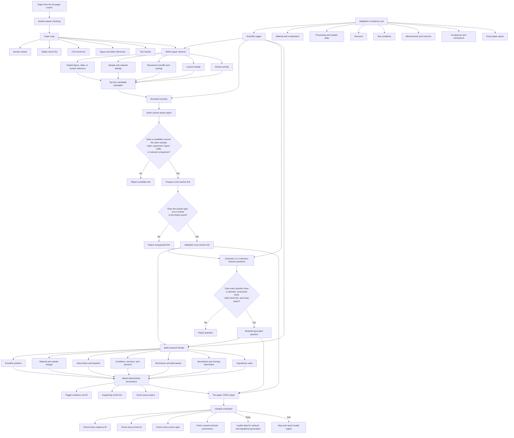

# Section-aware data-extraction agent

This directory contains the newest data produced by the section-aware extraction agent for the
50-paper high-temperature high-entropy-alloy corpus.

The agent solves a problem that cannot be handled reliably by reading one paragraph in isolation.
A result may appear in the Results section, while the information needed to understand it may be
spread across Methods, Discussion, a figure caption, or a table. The agent starts from a validated
scientific result, retrieves related passages from the same paper, checks whether they really refer
to the same experiment, and then produces useful scientific questions and a structured research
thread.

The main outputs are in [`papers/`](./papers/). There is one JSON file for each paper.

## Pipeline at a glance


In brief, this pipeline starts from a validated scientific result, searches elsewhere in the same
paper for the method, sample history, figure, comparison, mechanism, or boundary needed to
understand it, and generates questions only after Qwen checks that those passages belong together.

## The central idea

Consider a simplified paper:

```text
Methods:
The alloy was aged at 800 C for 10 hours.

Results:
The aged alloy had 35% higher yield strength.

Figure caption:
Fine precipitates formed after aging.

Discussion:
The authors attribute the strength increase to precipitation hardening.
```

A chunk-only question generator might see only the Results sentence and ask:

> Why did the strength increase?

The section-aware agent can connect all four passages and ask a more useful question:

> Is the 35% strength increase caused mainly by the fine precipitates formed during the 800 C,
> 10-hour aging treatment, or could another change in sample state explain the result?

The second question is more useful for hypothesis generation because it preserves the connection:

```text
processing -> structure -> measured property -> proposed mechanism -> alternative explanation
```

## Important distinction: facts, questions, and synthesis

The pipeline deliberately keeps three kinds of information separate:

| Data type | Meaning | Can it be treated as a fact? |
|---|---|---|
| Validated v2 evidence | Structured information directly grounded in paper text | Yes, within its stated conditions and provenance |
| Generated question | An information need, uncertainty, comparison, or possible experiment | No |
| Research thread | Qwen's structured synthesis of the supplied grounded context | Not automatically; it remains an interpretation layer |

Questions are therefore **not** the primary factual database. They are the reasoning and retrieval
interface over the validated evidence.

## Complete agent flowchart



## Simplified flow

```text
Paper
  |
  v
Paper map: where is information located?
  |
  +-------------------------+
  |                         |
  v                         v
Validated evidence      Related passages from
from the paper          other paper sections
  |                         |
  +------------+------------+
               |
               v
        Qwen checks whether
        the passages belong together
               |
               v
      Cross-section scientific question
               |
               v
          Research thread
               |
               v
 Exact evidence IDs, chunk IDs, and source spans
               |
               v
       Hypothesis-generation input
```

## Inputs

The agent uses three existing inputs.

### 1. Corpus text

Location:

```text
../data/corpus/text/
```

Each paper is stored as a text file converted from its open-access JATS XML. Section headings,
paragraphs, figure captions, table text, and textual figure/table references are retained where
available.

### 2. Validated v2 evidence

Location:

```text
../temporal_v2/materials_evidence_v2/
```

Each v2 evidence unit already connects:

- material and composition;
- sample state;
- processing steps;
- structure observations;
- test conditions;
- measurements;
- baseline and changed variables;
- mechanism;
- boundary or limitation;
- exact source spans.

These evidence units are the factual triggers for the new agent. The section-aware agent does not
start from arbitrary sentences.

### 3. Qwen backbone

The run used:

- Qwen3.5-35B-A3B;
- Q4_K_M GGUF quantization;
- local llama.cpp inference;
- four Tesla V100 GPUs;
- four inference slots;
- 32,768 tokens per slot;
- hidden thinking disabled for structured JSON generation.

No paper content is sent to an external model provider.

## Stage 1: Build a paper map

The paper is divided using the shared section-aware chunker. Real headings such as Methods,
Results, and Discussion are preferred. If reliable headings are unavailable, the chunker falls
back to overlapping windows.

Every chunk receives:

```json
{
  "chunk_id": "PMC123::chunk::003::methods::a1b2c3d4e5",
  "section": "Methods",
  "chunk_index": 3,
  "content_types": [
    "text",
    "figure_caption_or_reference"
  ],
  "text": "Full text of this chunk",
  "text_sha256": "..."
}
```

The stable chunk ID allows all questions and research threads to point back to the exact paper
location. The SHA-256 hash makes accidental source changes detectable.

The paper maps are stored in [`paper_maps/`](./paper_maps/).

## Stage 2: Select a scientific trigger

Each of the 276 validated v2 evidence units becomes one trigger.

A compact trigger sent to the agent contains:

```json
{
  "evidence_unit_id": "PMC123::hypothesis_evidence_v2::...",
  "source_section": "Results",
  "claim_ownership": "current_paper",
  "sample": {},
  "process_steps": [],
  "structure_observations": [],
  "test_conditions": {},
  "measurements": [],
  "comparison": {},
  "mechanisms": [],
  "boundaries": [],
  "limitations": [],
  "evidence_spans": []
}
```

This trigger tells the agent which scientific result it is trying to understand more completely.

## Stage 3: Retrieve related passages from the same paper

Retrieval is deterministic; Qwen does not search the whole paper by itself.

The system scores paper chunks using:

1. **Explicit references**: Figure 3, Table 2, or Section 2.1.
2. **Sample identity**: exact sample ID, material name, or nominal composition.
3. **Scientific overlap**: processing, structure, condition, property, and mechanism terms.
4. **Lexical overlap**: shared meaningful words.
5. **Section priority**: a Results trigger receives an additional preference for Methods,
   Materials, Experimental, Discussion, and Results-and-Discussion passages.

Anchor chunks containing the trigger's exact evidence spans are always included. Up to four other
candidate chunks are retrieved.

This is hybrid retrieval, but it intentionally does not use semantic similarity alone. Two passages
can use similar words while describing different samples or experiments.

## Stage 4: Bound the context

Full paper sections can be very large. Sending several complete sections caused prompts to exceed
the 32,768-token slot limit during development.

The corrected pipeline sends bounded excerpts:

- the exact trigger span plus nearby context for anchor chunks;
- the highest-overlap sentences or paragraphs for retrieved chunks;
- no more than 2,400 characters per chunk excerpt;
- two evidence triggers per Qwen call.

This keeps the prompt within context while preserving the most relevant evidence.

## Stage 5: Qwen checks and connects the passages

The core Qwen instruction is:

> Inspect retrieved passages from other parts of the same paper. First reject passages that do not
> describe the same sample, material state, experiment, figure, table, or directly relevant
> scientific comparison. Similar wording alone is not enough.

This is the most important model decision. Retrieval only proposes candidates; Qwen decides whether
the scientific connection is meaningful.

For each accepted connection, Qwen returns:

```json
{
  "chunk_id": "PMC123::chunk::003::methods::...",
  "relation": "method",
  "evidence_spans": [
    "An exact sentence copied from the retrieved chunk."
  ],
  "reason": "This passage defines the heat treatment used for the measured sample."
}
```

Allowed relation concepts include:

- method;
- sample lineage;
- figure;
- table;
- mechanism;
- comparison;
- boundary.

The completed run also contains a few semantically equivalent labels such as `outcome` or
`structure`; these are reported transparently in the quality review.

## Stage 6: Generate useful cross-section questions

For each trigger, Qwen may create one to three questions. It is explicitly allowed to create no
question when retrieval adds no scientifically useful context.

The prompt requires questions that connect at least some of:

- processing;
- structure;
- test conditions;
- measurement;
- comparison;
- mechanism;
- boundary;
- limitation.

It also says:

> Do not ask a question that the supplied context already answers completely. Record the known
> context and ask only about the unresolved scientific issue.

Superficial questions are excluded. The supported question functions are:

| Function | Purpose |
|---|---|
| `explain_mechanism` | Ask what physical mechanism explains the observation |
| `test_evidence` | Ask whether the supplied evidence actually supports a claim |
| `compare` | Compare materials, processing routes, baselines, or results |
| `find_boundary` | Identify where a relationship stops working |
| `replicate` | Identify missing details needed to reproduce the experiment |
| `change_variable` | Ask what happens when one controlled variable changes |
| `transfer` | Test whether a finding may apply to another material or condition |
| `plan_experiment` | Propose a measurement that distinguishes explanations |

A retained question has this form:

```json
{
  "question_id": "PMC123::cross_section_question::...",
  "question": "Does the precipitate population produced by aging explain the strength increase?",
  "question_function": "explain_mechanism",
  "why_it_matters": "This separates the proposed mechanism from alternative explanations.",
  "known_context": "The paper reports aging, precipitates, and higher strength.",
  "unresolved_information": "The precipitate contribution was not isolated from grain-size effects.",
  "source_chunk_ids": [
    "PMC123::chunk::002::results::...",
    "PMC123::chunk::004::methods::..."
  ],
  "evidence_spans": [
    "Exact text copied from the paper."
  ],
  "confidence": 0.9
}
```

## Stage 7: Build a research thread

A research thread organizes everything needed to reason about the trigger:

```json
{
  "scientific_problem": "What problem is the study trying to solve?",
  "material_system": "Which alloy or material is involved?",
  "sample_lineage": "How was the tested sample produced from its parent state?",
  "intervention": "What did the researchers change?",
  "baseline": "What was the comparison?",
  "conditions": "Under what temperature, environment, load, or time?",
  "structure": "What phase, precipitate, grain, defect, or scale was observed?",
  "outcome": "What property or behavior changed?",
  "mechanism": "What explanation was proposed?",
  "alternative_explanations": [],
  "boundaries": [],
  "null_or_negative_results": [],
  "missing_information": [],
  "hypothesis_value": "Why this evidence may help generate a hypothesis"
}
```

The thread is not allowed to float without provenance. The pipeline deterministically adds:

```json
{
  "provenance": {
    "trigger_evidence_unit_id": "PMC123::hypothesis_evidence_v2::...",
    "supporting_chunk_ids": [],
    "evidence_spans": []
  }
}
```

This makes the thread auditable. It does not guarantee that every phrase written by Qwen is fully
entailed; expert review is still important.

## The Qwen prompt, in plain language

The actual structured prompt is implemented in
[`section_aware_extraction.py`](../../../section_aware_extraction.py). In plain language, it asks:

```text
For each validated evidence trigger:

1. Inspect the passages retrieved from other parts of the same paper.
2. Reject passages about a different sample, state, experiment, or irrelevant comparison.
3. Keep only scientifically valid cross-section links.
4. Copy exact supporting spans for every accepted link.
5. Generate one to three questions that matter for hypothesis generation.
6. Do not ask something already answered completely.
7. State what is already known.
8. State exactly what remains unresolved.
9. Explain why the question matters.
10. Build a research thread connecting material, processing, structure, conditions,
    outcome, mechanism, alternatives, boundaries, and missing information.
11. Use only the supplied content.
12. Do not invent evidence IDs, chunk IDs, or external knowledge.
```

## Deterministic validation after Qwen

Model output is never accepted directly.

The validator checks:

### Cross-section links

- The chunk ID must be one of the chunks supplied to Qwen.
- At least one quoted span must occur exactly in that chunk.
- Unsupported or non-verbatim spans are rejected.

### Questions

- The question must be non-empty and end with `?`.
- Duplicate question text is removed.
- `why_it_matters` must be present.
- `unresolved_information` must be present.
- Source chunk IDs must be allowed.
- At least one evidence span must occur exactly in a cited source chunk.
- Confidence is constrained to the interval 0 to 1.

### Research-thread provenance

- The trigger evidence ID must exist.
- Every supporting chunk ID must exist in the paper map.
- Every provenance span must occur exactly in one of those chunks.

If Qwen fails to produce a valid trigger object, the pipeline writes an explicit fallback record
with the failure reason. It does not create a success-shaped scientific answer.

## One complete per-paper output

Each file in [`papers/`](./papers/) has this top-level shape:

```json
{
  "schema_version": "section-aware-extraction-1.0",
  "paper_id": "PMC123",
  "provider": "openai",
  "trigger_count": 5,
  "cross_section_link_count": 11,
  "question_count": 9,
  "triggers": [
    {
      "evidence_unit_id": "...",
      "anchor_chunk_ids": [],
      "validated_links": [],
      "questions": [],
      "research_thread": {}
    }
  ],
  "rejected": []
}
```

`provider: "openai"` refers to the OpenAI-compatible local llama.cpp API. The actual model was the
local Qwen model described above.

## How the hypothesis-generation agent should use this data

The recommended retrieval path is:


The hypothesis agent should not receive questions alone. It should receive:

1. the query;
2. relevant section-aware questions;
3. their known context and unresolved issue;
4. relevant research threads;
5. the underlying v2 evidence units;
6. exact provenance;
7. contradictions and boundaries from other eligible papers.

This design uses questions to guide reasoning while keeping evidence as the factual substrate.

## Completed 50-paper run

| Measure | Result |
|---|---:|
| Papers | 50 |
| Validated v2 evidence triggers | 276 |
| Retained questions | 482 |
| Validated cross-section links | 588 |
| Questions spanning more than one section | 317 |
| Cross-section question rate | 65.77% |
| Triggers with at least one question | 274 |
| Exact validated spans | 3,307 / 3,307 |
| Grounding rate | 100% |
| Unknown evidence IDs | 0 |
| Unknown chunk IDs | 0 |
| Invalid research-thread provenance | 0 |

Question functions:

| Function | Count |
|---|---:|
| Explain mechanism | 135 |
| Compare | 112 |
| Test evidence | 109 |
| Find boundary | 90 |
| Plan experiment | 16 |
| Change variable | 7 |
| Transfer | 7 |
| Replicate | 6 |

Validated links included:

| Link type | Count |
|---|---:|
| Comparison | 152 |
| Mechanism | 125 |
| Figure caption or reference | 97 |
| Method | 86 |
| Sample lineage | 76 |
| Boundary | 41 |
| Table | 5 |

## What was rejected

The completed run preserves rejection information instead of hiding model errors:

- 84 proposed links were rejected because their quoted text was not an exact substring of the
  linked chunk;
- 4 questions were rejected because they lacked either a scientific rationale or a clearly stated
  unresolved issue;
- 1 invented or unknown linked chunk ID was rejected;
- 2 malformed or missing trigger responses were converted to explicit fallback records.

These rejections are desirable. An unsupported link should not become evidence merely because a
model produced it.

## Output directory

```text
section_aware/
├── README.md
├── COMPLETE
├── status.json
├── outputs/
│   ├── 1/
│   │   ├── paper.pdf
│   │   ├── paper.xml
│   │   ├── metadata.json
│   │   └── extracted_questions.json
│   ├── ...
│   ├── 50/
│   └── index.json
├── paper_maps/
│   ├── PMC10142552.json
│   ├── ...
│   └── PMC9955357.json
├── papers/
│   ├── PMC10142552.json
│   ├── ...
│   ├── PMC9955357.json
│   └── summary.json
└── results/
    ├── evaluation.json
    └── quality_review.json
```

### `outputs/`

[`outputs/`](./outputs/) provides an easy-to-browse, self-contained bundle for every paper. Folder
numbers follow the canonical citation-ranked corpus manifest:

```text
outputs/<rank>/
├── paper.pdf
├── paper.xml
├── metadata.json
└── extracted_questions.json
```

- `paper.pdf` is the original open-access PDF for visual inspection.
- `paper.xml` is the original open-access JATS XML from which the corpus text was derived.
- `metadata.json` records the rank, PMC ID, title, DOI, publication year, license, pipeline, and
  question count.
- `extracted_questions.json` is the complete section-aware output for that paper. It contains the
  evidence triggers, anchor chunks, validated cross-section links, extracted questions, known
  context, unresolved information, research threads, provenance, and rejected records.
- `index.json` maps ranks 1 through 50 to paper IDs and metadata.

These are presentation bundles. The canonical section-aware records remain in `papers/`, and each
bundle's metadata points to its canonical source.

### `paper_maps/`

Deterministic representation of every section and chunk. Use this to recover the full text behind a
chunk ID.

### `papers/`

The main new data-agent output. Each paper contains triggers, validated cross-section links,
questions, research threads, provenance, and rejected records.

### `papers/summary.json`

Corpus-level output totals.

### `results/evaluation.json`

Deterministic integrity audit for evidence IDs, chunk IDs, exact spans, and research-thread
provenance.

### `results/quality_review.json`

Distributions of question functions, link relations, linked sections, rejection reasons, and a
summary of scientific strengths and limitations.

### Runtime-only files

The following are intentionally excluded from Git:

- `logs/`;
- `checkpoints/`;
- PID files;
- server-health snapshots.

They are useful while the run is active but are not canonical scientific results.

## Reproduce the experiment

From the repository root:

```bash
tmux new-session -d -s mathg-section-aware \
  "cd $(pwd) && bash run_section_aware_experiments.sh"
```

The orchestration script:

1. creates output and log directories;
2. starts the local Qwen llama.cpp server if it is not already running;
3. waits for a successful health check;
4. sets the local OpenAI-compatible model configuration;
5. processes the 50 papers with four workers;
6. resumes completed checkpoints rather than repeating them;
7. runs the deterministic integrity evaluation;
8. writes `COMPLETE` only after all stages succeed.

Monitor the run:

```bash
cat experiments/high_temperature_hea_qwen35b/section_aware/status.json
tail -f experiments/high_temperature_hea_qwen35b/section_aware/logs/pipeline.log
tmux attach -t mathg-section-aware
```

Run only the integrity evaluation:

```bash
.venv/bin/python section_aware_extraction.py evaluate \
  --text-dir experiments/high_temperature_hea_qwen35b/data/corpus/text \
  --evidence-dir experiments/high_temperature_hea_qwen35b/temporal_v2/materials_evidence_v2 \
  --output-dir experiments/high_temperature_hea_qwen35b/section_aware/papers \
  --output experiments/high_temperature_hea_qwen35b/section_aware/results/evaluation.json
```

## What this experiment demonstrates

The agent can follow a scientific result into other parts of the same paper and produce questions
that connect methods, sample history, structure, conditions, measurements, comparisons, mechanisms,
and boundaries.

The strongest result is not simply that 482 questions were generated. It is that:

- 317 questions cite more than one paper section;
- every retained source span is exact;
- every evidence and chunk identifier is valid;
- questions explicitly state what is known and what remains unresolved;
- research threads retain deterministic provenance.

## Limitations and next improvements

### Figures are text-grounded, not pixel-interpreted

The current system uses figure captions and textual figure references. It does not inspect image
pixels, plot curves, microscopy features, legends, or error bars directly. A future vision stage
should label image-derived interpretations separately from author-written text.

### Tables depend on imported XML text

Tables are usable when their captions or cells are represented in the imported corpus text. Complex
table structure may not be fully preserved.

### Retrieval can miss implicit links

The hybrid retriever performs well when passages share sample names, material terms, explicit
references, or scientific vocabulary. It can miss a relationship expressed with entirely different
terminology.

### Research threads are model synthesis

Provenance proves that the source passages exist and were supplied. It does not prove that every
field-level interpretation is scientifically entailed. Materials-expert review remains necessary.

### Question quality is not the same as hypothesis quality

The experiment validates extraction integrity and inspects scientific usefulness. The next
evaluation should test whether adding these section-aware threads improves temporally leakage-safe
hypothesis reconstruction compared with v2 evidence and the earlier question-centered variants.

### The model cutoff is undocumented

Qwen3.5-35B-A3B has no documented public knowledge cutoff. Any future chronological benchmark using
this backbone must be described as retrospective temporal reconstruction, not strict unseen-future
prediction.
